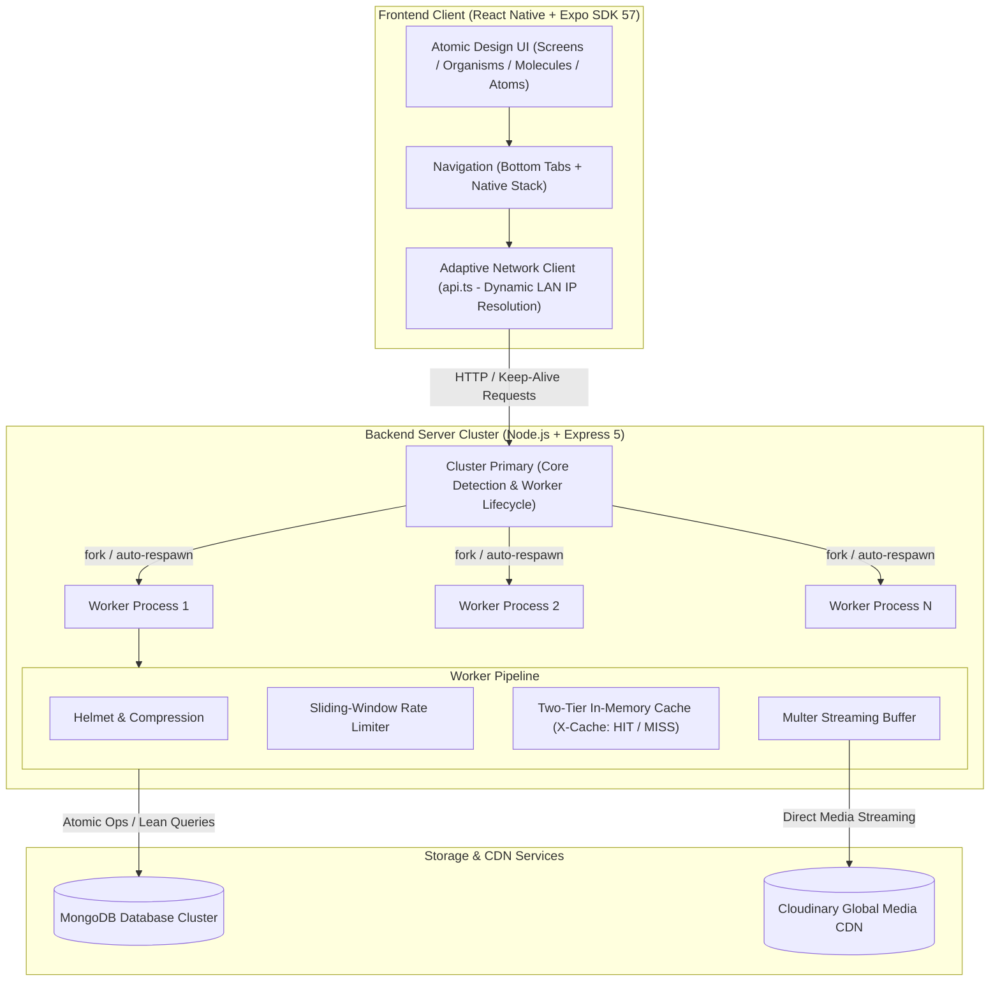
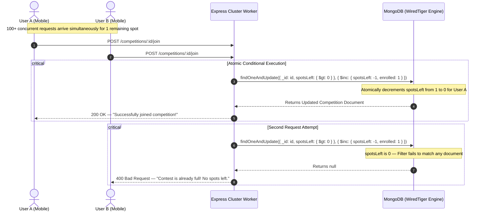

# 🏆 Feedants — High-Concurrency Talent & Competition Platform

[](https://nodejs.org/)
[](https://expressjs.com/)
[](https://reactnative.dev/)
[](https://expo.dev/)
[](https://www.typescriptlang.org/)
[](https://www.mongodb.com/)
[](https://www.docker.com/)
[](https://cloudinary.com/)

---

## 📌 Executive Summary

**Feedants** is a high-throughput, full-stack talent discovery and competition platform built for creators, adjudicators, and audiences. The platform powers national-level skill championships, verified jury evaluations, atomic spot reservations under heavy concurrency, high-definition multimedia submissions, and live community voting.

The codebase consists of:

- **High-Concurrency Backend API** (`/backend`): A clustered, production-tuned Node.js / Express 5 service backed by MongoDB with connection pooling, in-memory caching, atomic write operations, and Cloudinary media processing.
- **Cross-Platform Mobile Client** (`/frontend`): A mobile-first React Native & Expo application designed with strict **Atomic Design** principles (`atoms`, `molecules`, `organisms`, `screens`), bilingual localization (English / Hindi), adaptive LAN IP detection for physical hardware, and optimized micro-interactions.

---

## 🏗️ System Architecture

Feedants is architected as a decoupled, multi-tier system engineered to sustain 10,000+ concurrent requests during marquee competition drop events and voting spikes.



### 1. High-Concurrency Backend Architecture

- **Primary / Worker Multi-Process Clustering**: Utilizes Node.js `node:cluster` to saturate all physical CPU cores with independent worker processes. If a worker encounters an unhandled fatal condition, the primary instantly forks a replacement worker, guaranteeing zero downtime.
- **HTTP Keep-Alive Connection Tuning**: HTTP server parameters (`keepAliveTimeout: 65000ms`, `headersTimeout: 66000ms`, `maxRequestsPerClient: 0`) minimize TCP handshake overhead under extreme request volumes.
- **Pre-Warmed Database Connection Pooling**: Mongoose connection pooling is pre-warmed (`minPoolSize: 10`, `maxPoolSize: 100`) to prevent cold-start latency spikes and TCP socket starvation.
- **Two-Tier In-Memory Route Caching**: High-read routes (`/competitions`, `/explore`, `/champions`) are served directly from an in-memory cache with sub-5ms response times and deterministic invalidation on mutations.
- **Atomic Concurrency Guarantee**: Contest registrations utilize atomic conditional operators (`findOneAndUpdate` with `{ spotsLeft: { $gt: 0 } }`), eliminating race conditions without distributed lock contention.

### 2. Mobile Client Architecture

- **Atomic Design Component Hierarchy**: UI elements are decomposed into pure `atoms` (Badge, Chip, IconButton), composite `molecules` (CategoryCard, JudgeCard, SearchBar, ContestHeader), and complex `organisms` (CompetitionCard, LeaderboardPodium, RewardsTable, WalletCard).
- **Adaptive Network Layer**: Dynamically determines the host computer's local Wi-Fi IP address at runtime via Expo Constants, allowing instant physical device testing on local networks without manual IP reconfiguration.
- **Bilingual Localization**: Built-in instant language switching between **English** and **Hindi** with localized typography and translation maps.
- **Optimistic State & Resilient UI**: High-frequency actions like voting and category filtering provide instantaneous visual feedback while dispatching background synchronization.

---

## ⚡ Concurrency & Atomic Spot Reservation Flow

Marquee talent competitions experience intense burst traffic when registration opens for strictly limited spots. Traditional read-then-write patterns (`SELECT spots -> if spots > 0 -> UPDATE spots`) suffer from critical race conditions, causing overselling.

Feedants enforces concurrency safety directly at the database storage engine layer:



---

## 🎯 Key Features Across the Stack

### 📱 Frontend Experience (React Native + Expo)

1. **Home Feed & Marquee Showcase**:
   - Spotlight Mega-Contest hero banner with dynamic countdown timer.
   - Active registration alert bar displaying imminent submission deadlines and allocated slot numbers.
   - Filterable talent categories (Classical Dance, Hip-Hop, Vocal Music, Instrumental, Fine Arts, Theater).
   - Live Competition cards with urgency progress indicators ("Few Spots Left").
   - Hall of Fame Champions carousel.
2. **Competitions Catalog & Search**:
   - Status-based filtering (`All`, `Live`, `Upcoming`).
   - Real-time search across titles, judges, and tags.
   - Quick spot indicators and direct navigation to detailed entry requirements.
3. **Contest Details & Flash Registration**:
   - Bilingual support: One-tap toggle between **English** and **Hindi**.
   - Atomic reservation flow preventing overselling of seats.
   - Prize pool distribution hierarchy table and official certification guidelines.
   - Adjudicator profile with credentials and masterclass video preview.
   - Referral program with native sharing (`Share API`) and one-tap clipboard copy.
4. **Explore & Discovery Hub**:
   - Adjudicator masterclass preview cards with booking hooks.
   - Monthly Podium Leaderboard showcasing top talent rankings and community points.
   - Trending performance video cards with live upvoting and view counters.
5. **Creator Studio & Performance Upload**:
   - Native camera and media library integration via `expo-image-picker`.
   - Live video/photo preview, title/description tagging, and seamless Cloudinary upload pipeline.
   - Automatic contest linkage updating registration status from `Registered` to `Submitted`.
6. **Creator Profile & Digital Wallet**:
   - Creator profile with verified badges and dynamic interest tags.
   - Digital Wallet showing current contest earnings and withdrawal action.
   - My Competitions manager segmented by status (`Registered`, `Upcoming`, `Submitted`).
   - Verified Achievement showcase with digital certificate preview.

### ⚙️ Backend Engineering (Node.js + Express + MongoDB)

1. **Engineered for 10,000+ Concurrent Requests**:
   - Multi-process primary/worker clustering utilizing all CPU cores with automatic healing respawn.
   - HTTP keep-alive optimization (`keepAliveTimeout: 65000ms`, `headersTimeout: 66000ms`, unlimited client reuse).
   - Pre-warmed MongoDB connection pool (`minPoolSize: 10`, `maxPoolSize: 100`) preventing TCP handshake bottlenecks.
2. **Atomic Consistency Under Contention**:
   - Zero-oversubscription contest booking using single-operation conditional atomic updates (`$inc` guarded by `{ spotsLeft: { $gt: 0 } }`).
   - High-throughput vote counting without document locks.
3. **Low-Latency In-Memory Caching**:
   - Two-tier caching middleware serving hot read endpoints (`/competitions`, `/explore`, `/champions`) in sub-5ms with cache hit/miss headers (`X-Cache: HIT / MISS`).
   - Deterministic cache invalidation on write events (`createCompetition`, `joinCompetition`, `createSubmission`).
4. **Enterprise Defense & Standardization**:
   - Sliding-window rate limiting protecting against abusive bursts and DDoS attacks.
   - Uniform payload envelope via custom `ApiResponse` and `ApiError` classes.
   - Lean query projection (`.lean().exec()`) bypassing Mongoose document hydration overhead on read paths.

---

## 📂 Repository Structure

```text
.
├── backend/                       # Node.js + Express + MongoDB Backend Service
│   ├── app.js                     # Express app configuration & middleware pipeline
│   ├── constants.js               # Application constants & database identifiers
│   ├── index.js                   # Cluster manager, server bootstrap & HTTP tuning
│   ├── src/
│   │   ├── config/                # Database connection pooling & options
│   │   │   └── db.js
│   │   ├── controllers/           # Business logic & atomic query controllers
│   │   │   ├── champion.controller.js
│   │   │   ├── competition.controller.js
│   │   │   ├── explore.controller.js
│   │   │   ├── submission.controller.js
│   │   │   └── user.controller.js
│   │   ├── middlewares/           # Caching, rate limiting, and Multer upload
│   │   │   ├── cache.middleware.js
│   │   │   ├── multer.middleware.js
│   │   │   └── rateLimiter.middleware.js
│   │   ├── models/                # Mongoose schemas & compound indexes
│   │   │   ├── achievement.model.js
│   │   │   ├── category.model.js
│   │   │   ├── champion.model.js
│   │   │   ├── competition.model.js
│   │   │   ├── judge.model.js
│   │   │   ├── leaderboard.model.js
│   │   │   ├── registration.model.js
│   │   │   ├── submission.model.js
│   │   │   └── user.model.js
│   │   ├── routes/                # Express 5 REST API route modules
│   │   │   ├── champion.routes.js
│   │   │   ├── competition.routes.js
│   │   │   ├── explore.routes.js
│   │   │   ├── health.routes.js
│   │   │   ├── submission.routes.js
│   │   │   └── user.routes.js
│   │   └── utils/                 # Standardized response envelopes & Cloudinary
│   │       ├── apiError.js
│   │       ├── apiResponse.js
│   │       ├── asyncHandler.js
│   │       └── cloudinary.js
│   ├── Dockerfile                 # Production container image definition
│   ├── .dockerignore
│   ├── .env.example               # Backend environment blueprint
│   └── package.json
│
├── frontend/                      # React Native + Expo Mobile Application
│   ├── App.tsx                    # Root provider entry point
│   ├── app.json                   # Expo configuration manifest
│   ├── src/
│   │   ├── components/
│   │   │   ├── atoms/             # Primitive UI building blocks (Badge, Chip, IconButton)
│   │   │   ├── molecules/         # Composite units (ContestHeader, CountdownBanner, JudgeCard, SearchBar, etc.)
│   │   │   └── organisms/         # Complex components (CompetitionCard, RewardsTable, WinnerCarousel, etc.)
│   │   ├── navigation/            # Navigation routing & type definitions
│   │   │   ├── AppNavigator.tsx   # BottomTabNavigator & NativeStack routing
│   │   │   └── types.ts           # Navigation param lists
│   │   ├── screens/               # Screen compositions
│   │   │   ├── HomeScreen.tsx
│   │   │   ├── CompetitionsScreen.tsx
│   │   │   ├── ContestDetailsScreen.tsx
│   │   │   ├── ExploreScreen.tsx
│   │   │   ├── CreateScreen.tsx
│   │   │   └── ProfileScreen.tsx
│   │   ├── services/
│   │   │   └── api.ts             # Adaptive networking client (Auto LAN IP detection)
│   │   └── theme.ts               # Design tokens (Teal brand palette, spacing, typography)
│   ├── .env.example               # Frontend environment blueprint
│   └── package.json
│
├── docker-compose.yml             # Container orchestration (Backend + MongoDB)
├── .gitignore
├── .prettierrc
└── README.md                      # Project documentation & engineering analysis
```

---

## 🛠️ Technology Stack

| Domain | Technology | Version | Purpose |
| :--- | :--- | :--- | :--- |
| **Backend Runtime** | Node.js | v20+ | Event-driven JavaScript runtime with native multi-core clustering |
| **API Framework** | Express.js | 5.x | High-throughput HTTP routing and middleware orchestration |
| **Database** | MongoDB | 7.x | Document database with WiredTiger storage engine for microsecond atomic updates |
| **ODM** | Mongoose | 9.x | Schema modeling, connection pool management, and compound index enforcement |
| **Mobile Runtime** | React Native | 0.86.x | Cross-platform native mobile compilation |
| **Mobile Toolchain** | Expo | SDK 57 | Application bundler, native asset pipeline, and device runtime |
| **Navigation** | React Navigation | 7.x | Native stack transitions and fluid bottom tab navigation |
| **Language** | TypeScript / ES Modules | 5.x / ESM | Static typing on client and modern ES module syntax on server |
| **Media Pipeline** | Cloudinary + Multer | 2.x | Memory buffer ingestion with streaming upload to global CDN |
| **Containerization**| Docker & Docker Compose | Latest | Reproducible development and deployment environments |

---

## 📡 API Reference Overview

All backend responses conform to a standardized JSON response envelope:

### Success Response Envelope
```json
{
  "statusCode": 200,
  "data": { ... },
  "message": "Operation description",
  "success": true
}
```

### Error Response Envelope
```json
{
  "statusCode": 400,
  "success": false,
  "message": "Descriptive error message",
  "errors": []
}
```

---

## 🚀 Quick Start Guide

### Prerequisites

- **Docker & Docker Compose** (Recommended for instant setup) OR **Node.js v20+ & MongoDB**
- **Expo Go App**: Installed on physical Android / iOS device (or simulator)
- **Cloudinary Account**: Cloud name, API key & secret for media uploads (optional for browsing)

---

### 1. Backend Setup

#### Option A: One-Command Docker Setup (Recommended)

From the project root:

```bash
docker compose up -d
```

This spins up MongoDB and the clustered Node.js backend automatically.

Verify health:
```bash
curl http://localhost:5000/api/v1/health
```

To view logs or stop:
```bash
docker compose logs -f backend
docker compose down
```

#### Option B: Native Node.js Setup

```bash
cd backend
npm install
cp .env.example .env
```

Configure `.env` with your `MONGO_URI`, then run:

```bash
npm run dev       # Development mode with watch
# or
npm start         # Clustered production mode
```

Verify health: `http://localhost:5000/api/v1/health`

---

### 2. Frontend Setup

```bash
# Open a new terminal and navigate to frontend
cd frontend

# Install dependencies
npm install

# Configure environment variables
cp .env.example .env
```

Open `frontend/.env` and verify:

```env
EXPO_PUBLIC_API_URL=http://localhost:5000/api/v1
EXPO_PUBLIC_APP_ENV=development
```

> **Adaptive LAN IP Detection**: On physical mobile devices, `localhost` refers to the mobile phone itself. Our custom networking service ([`frontend/src/services/api.ts`](frontend/src/services/api.ts)) automatically extracts your computer's local Wi-Fi IP from the Expo bundler host URI at runtime. You do not need to manually edit IP addresses when switching between PC web and physical phone testing.

Launch the Expo Development Server:

```bash
npx expo start
```

- **Physical Device**: Scan the generated QR code using the Expo Go application (Android) or Camera app (iOS). Ensure phone and PC are on the same Wi-Fi network.
- **Web Browser**: Press `w` in the terminal to run in Chrome / browser.
- **Android Emulator**: Press `a`.
- **iOS Simulator**: Press `i`.

---

## 🎨 Design Tokens & UI Architecture

The frontend leverages a centralized design token system defined in [`frontend/src/theme.ts`](frontend/src/theme.ts):

### Color System (Teal & Emerald Foundation)
- **Primary Brand**: `#005c55` (Primary Deep Teal), `#0f766e` (Primary Container), `#a3faef` (On Primary Container), `#9cf2e8` (Primary Fixed).
- **Secondary Accent**: `#006b5f` (Secondary), `#6df5e1` (Secondary Container).
- **Brand Spectrum**: Graded from `#f0fdfa` (brand50) through `#14b8a6` (brand500) to `#134e4a` (brand900).
- **Surface Hierarchy**: `#f8f9ff` (Canvas Background), `#eff4ff` (Low), `#e5eeff` (Container), `#dce9ff` (High), `#d3e4fe` (Highest).
- **Accent & Awards**: `#f59e0b` (Amber / Gold Leaderboard), `#d97706` (Amber Accent).
- **Status & Urgency**: `#ba1a1a` (Error / Urgency Alert), `#ffdad6` (Error Container).

### Spacing & Typography Scale
- **Spacing Grid**: Normalized 8pt system from `xs` (2px), `sm` (4px), `md` (8px), `lg` (12px), `xl` (16px), up to `6xl` (48px).
- **Typography**: Fluid scale from `xs` (11px micro-captions) to `3xl` (28px display headers) paired with standardized font weights (`regular`, `medium`, `semiBold`, `bold`).
- **Border Radius**: Consistent rounding tokens from `sm` (4px) to `full` (9999px pill shapes).

---

## 🧪 Verification & Testing Runbook

### 1. Test Health Endpoint & Hardware Metrics

```bash
curl -X GET http://localhost:5000/api/v1/health
```

_Expected Output_: `200 OK` with JSON payload containing system status (`UP`), CPU core count, uptime, and memory metrics (`rss`, `heapTotal`, `heapUsed`).

### 2. Verify In-Memory Cache Headers

```bash
# First call (Cache Miss)
curl -i http://localhost:5000/api/v1/competitions
# Header check: X-Cache: MISS

# Second call within 15s (Cache Hit - Sub-5ms)
curl -i http://localhost:5000/api/v1/competitions
# Header check: X-Cache: HIT
```

### 3. Verify Atomic Concurrency on Registration

Simulate high-concurrency registration using a load-testing tool (e.g., `autocannon` or `k6`):

```bash
npx autocannon -c 100 -d 10 -m POST http://localhost:5000/api/v1/competitions/<CONTEST_ID>/join
```

_Expected Result_: Exactly `N` registrations succeed until `spotsLeft == 0`. Subsequent requests immediately receive `400 Bad Request: "Contest is already full!"` with zero over-enrollment or negative spot counts.

---

## 🔮 Production Scaling Roadmap

For scaling Feedants to an enterprise tier serving millions of concurrent active users, the following architectural milestones are recommended:

1. **Distributed Caching & Asynchronous Queue Ingestion (Redis + BullMQ)**:
   - Transition the in-process cache to a managed **Redis Sentinel / Cluster** for cross-pod cache synchronization and distributed rate limiting.
   - Offload media transcoding, video watermarking, automated fraud scoring, and push notifications to **BullMQ** worker threads backed by Redis.
2. **Database Read-Write Splitting & Sharding**:
   - Implement **MongoDB Replica Sets** with read preference routing: directed writes go to the primary node, while heavy catalog browsing queries are distributed across read secondaries (`readPreference: 'secondaryPreferred'`).
   - Shard the `submissions` and `registrations` collections by `{ contestId, createdAt }` to maintain constant-time query latency as data volumes reach tens of millions of records.
3. **Idempotent Payment Gateway Integration**:
   - Production integration with **Razorpay / Stripe Webhooks**:
     - Pre-registration order generation with server-side HMAC-SHA256 signature verification.
     - Database idempotency keys to guarantee a user is never double-charged during network retry loops.
     - Automated escrow wallet disbursement directly to winner bank accounts upon jury score finalization.
4. **Real-Time State Synchronization via WebSockets / SSE**:
   - Implement **Socket.io / Server-Sent Events (SSE)** for real-time contest dynamics:
     - Live broadcast of remaining spot countdowns (`"Only 2 spots left!"`) to all active viewers.
     - Live leaderboard position updates as adjudicators submit scores during championship finals.
5. **Observability, APM & Infrastructure as Code**:
   - Multi-stage Dockerfiles with non-root security contexts, Kubernetes Helm charts, and Horizontal Pod Autoscaling (HPA).
   - Instrument the backend with **OpenTelemetry**, exporting metrics to Prometheus/Grafana and distributed traces to Jaeger/Datadog for p99 latency monitoring and slow-query profiling.
